<div align="center">

# ⚡ ClipStream

### Stream in, videos out. · 直播流进，成片自动出。

**Live-watch detection → auto-record → danmaku × speech highlight mining → smart clipping → translate & dub → paced multi-account publishing → phone battle reports**

[English] · [中文](README.md)

[](https://github.com/mumuopen/ClipStream/releases)
[](https://go.dev/)
[-orange)](#️-roadmap)
[](LICENSE)
[](https://github.com/Geniusay/ChopperBot)

</div>

---

## 🎬 The problem, solved by one pipeline

The 4 a.m. comeback, the moment chat exploded with five thousand barrages — by next morning it's already clipped, subtitled, published, and the report is on your phone.

That's ClipStream: **an unattended live-clipping factory**. Recording starts when the stream starts, cutting starts when the stream ends. AI picks only the segments where chat heat and commentary peak, the review gate blocks the flops, and the publish pump releases clips evenly inside the active window — nobody needs to sit at the machine.

A Go rewrite inspired by [ChopperBot](https://github.com/Geniusay/ChopperBot): single pure-Go binary, no cgo, hardened on a production Windows server.

---

## ✨ Feature Matrix

| | Capability | Notes |
|:---:|---|---|
| 🎥 | **Live chain** | Bilibili + Huya detection · segmented recording · reconnect · stale-session auto-close · preview-state filtering |
| 💬 | **Danmaku signal** | Dual-platform WebSocket collection · 5s density buckets · live curve in console |
| 🎯 | **Dual-signal highlights** | whisper offline ASR × barrage interaction peaks → LLM picks 20-60s segments; falls back to barrage-peak clipping without an LLM |
| 🔪 | **Frame-accurate cutting** | FLV tag-level concat · timestamp normalization across merged segments · measured cut length matches annotation exactly |
| 📖 | **Subtitles** | LLM translation + bilingual/Chinese burn-in |
| 🎙️ | **AI narration** | edge-tts synthesis · speed-matched alignment |
| 🤖 | **Unattended loop** | 3-tier auto-review gate → publish pump paced in the active window (interval + daily cap + jitter) → room↔account bind-first routing → PushMe phone reports |
| 📱 | **Scan & done** | Bilibili + Douyin web QR login — **zero input, zero CLI**; account name customizable (blank = auto-nickname) |
| ⚙️ | **Auto engine install** | `clipstream engines install` detects missing engines → downloads from official sources (yt-dlp / ffmpeg / whisper+model / biliup), proxy-aware; core package stays ~40MB |
| 🌐 | **Console** | Bilingual Web UI · single URL · dual-platform QR modal |
| 🛡️ | **Server-grade hardening** | Fully isolated engine subprocesses (survive RDP drops / console closes / logoffs) · task recovery after crashes · 4-tier disk governance · pool backpressure (auto-pause recording when the queue is full, auto-resume once it drains) |

> 🔭 Additional platforms are scheduled via [Issues](https://github.com/mumuopen/ClipStream/issues).

---

## 🔄 Pipeline at a glance

```mermaid
flowchart LR
    A["Live detection<br/>Bilibili · Huya"] --> B["Segmented recording<br/>reconnect · stale close"]
    B --> C["Dual-signal analysis<br/>whisper ASR × barrage heat"]
    C --> D["LLM highlight<br/>20-60s precision cut"]
    D --> E["Processing<br/>bilingual subs · AI dub"]
    E --> F["Review gate<br/>reject / human / auto-pass"]
    F --> G["Publish pump<br/>paced in window"]
    G --> H["Multi-account routing<br/>label match · priority"]
    H --> I["PushMe report<br/>straight to phone"]
```



---

## 🆕 Highlights in v0.5.0

- **Zero-input QR login on both platforms** — one click, one scan, account auto-created with nickname and tags pulled automatically
- **Unattended-process immunity** (0xC000013A production incident) — RDP disconnects, console closes and logoffs no longer kill engine subprocesses; reproduced & verified on a real server
- **Cut precision** — timestamp normalization unifies the three axes on merged streams; the "30s annotated, 0.9s cut" class of bugs is fixed
- **Task recovery across restarts** — queue auto-resumes after crashes or power loss

Full history in [CHANGELOG](CHANGELOG.md) (Chinese).

---

## 🖼️ Screenshots

| Dashboard | Live Follow | Barrage Curve |
|:---:|:---:|:---:|
|  |  |  |

| Review | Publish Center | 中文 UI 🇨🇳 |
|:---:|:---:|:---:|
|  |  |  |

---

## 🚀 Quick Start

### Option A: Deploy package (recommended · zero environment)

> For unattended servers: unzip → double-click the launcher → done. Engines bundled; no Go/Python/Node required.

```text
ClipStream deploy package
├── bin\clipstream.exe            main program (web console)
├── bin\clipstream-daemon.exe     recording daemon
├── engines\                      yt-dlp / ffmpeg / whisper ... all bundled
├── config.yaml                   pre-filled template
└── start-unattended.cmd          double-click to run (self-detaching processes)
```

Then open `http://127.0.0.1:8899`: paste a room ID in **Live Follow** → fill your LLM key in **Settings** → scan a QR code in **Publish Center**.

### Option B: Build from source

```bash
# Requires Go 1.21+; engines optional (graceful degradation when missing)
go build -o bin/clipstream.exe ./cmd/clipstream
go build -o bin/clipstream-daemon.exe ./cmd/clipstream-daemon

cp config.example.yaml config.yaml   # fill engine paths & LLM key
./bin/clipstream init                 # engine health check
./bin/clipstream serve                # console → http://127.0.0.1:8899
./bin/clipstream-daemon               # live daemon (separate process)

# One-shot CLI: paste a video URL, run the full pipeline
./bin/clipstream run -i "https://www.bilibili.com/video/BVxxxx"
```

---

## 🏗️ Architecture


- **Pure Go · single binary**: cgo-free SQLite (modernc.org/sqlite), production-hardened on Windows Server
- **Process separation**: recorder daemon and web/pipeline run independently, avoiding parent-child FLV streaming IO pitfalls
- **Pluggable engines · graceful degradation**: no whisper → skip ASR; no LLM → barrage-peak clipping; no biliup → review-only
- **Unattended loop**: review gate → publish pump (paced by active-hours window, interval & daily caps) → bind-first account routing → publish → PushMe reports

> Source file `docs/architecture.drawio`, editable at [app.diagrams.net](https://app.diagrams.net).

---

## 📂 Layout

```text
├── cmd/clipstream           main program (serve / run / init / login / status)
├── cmd/clipstream-daemon    live-recording daemon
├── internal/biliapi         Bilibili login protocol (native Go, following biliup-rs MIT)
├── internal/config          configuration
├── internal/core            job model & event bus
├── internal/detach / wexec  process isolation (DETACHED engines · self-detaching services)
├── internal/engine          engine adapters
├── internal/live            live chain: Bilibili / Huya
├── internal/pipeline        five pipelines (clips / publish / subs / dub / live)
├── internal/publish         publishing & login sessions (Bilibili biliup / Douyin rod)
├── internal/store           SQLite storage
├── internal/web             console (embedded single-file)
└── configs/platforms        platform configs
```

---

## 🗺️ Roadmap

- [x] **v0.5.0** zero-input QR login · unattended immunity · cut precision · task recovery · 3-section console
- [ ] **Phase 2** — native-Go Bilibili upload (retire biliup.exe), zero external binaries end to end
- [ ] Douyin / Xiaohongshu / Kuaishou publishing
- [ ] More highlight strategies (voice emotion / scene detection); multi-recorder horizontal scaling

---

## 📖 Docs & Feedback

- [中文 README](README.md) · [CHANGELOG](CHANGELOG.md) · [Config example](config.example.yaml)
- Bugs & feature requests: open an [Issue](https://github.com/mumuopen/ClipStream/issues) (platform integrations, engines, publish channels…) · PRs welcome

## 🙏 Credits

A **standalone Go rewrite** inspired by [Geniusay/ChopperBot](https://github.com/Geniusay/ChopperBot) (Apache-2.0). The original source is for study only and is **not** distributed with this repo. Bilibili login protocol follows [biliup-rs](https://github.com/biliup/biliup-rs) (MIT). All bundled engines/libraries remain under their own licenses.

---

<div align="center">

**"Stream in, videos out."**

⭐ Star if it helps

</div>

> AI生成
