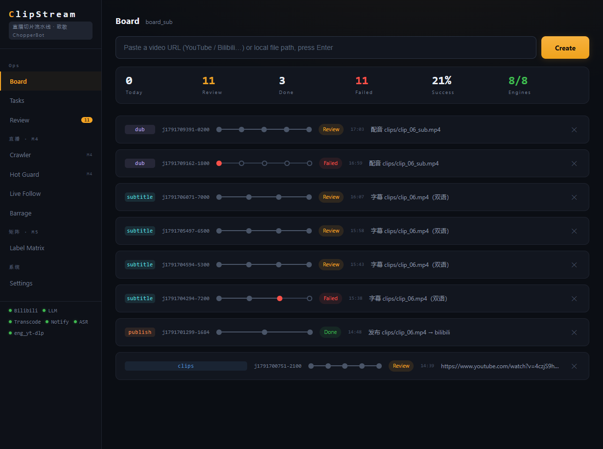
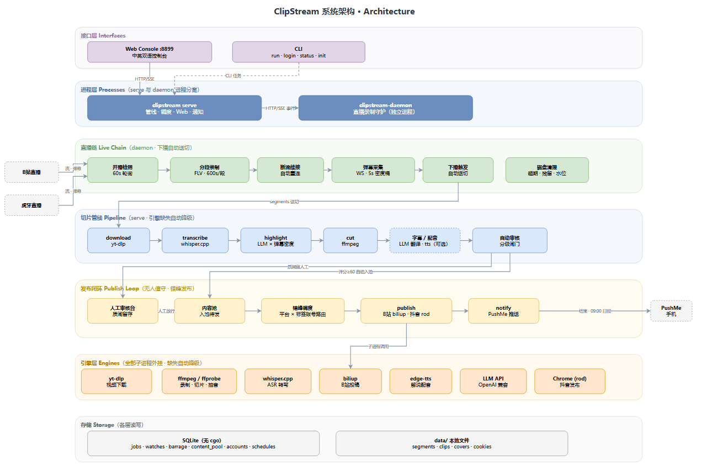

<div align="center">

# ⚡ ClipStream

### 直播流进，成片自动出 · Stream in, videos out.

**直播开播 → 自动录制 → 弹幕×语音双信号找高光 → 智能切片 → 翻译配音 → 自动匀速多账号发布 → 手机收战报**

**中文** · [English](README.en.md)

[](https://github.com/mumuopen/ClipStream/releases)
[](https://go.dev/)
[](#-roadmap)
[](LICENSE)
[](https://github.com/Geniusay/ChopperBot)

</div>

---

## 🎬 一个问题，一条流水线

游戏凌晨四点翻盘、弹幕炸了五千条的高能时刻——第二天早上已经剪好、配好字幕、发布完毕、战报推到手机上。

这就是 ClipStream 在做的事：**无人值守的直播切片工厂**。开播自动录，下播自动切，AI 只挑弹幕最热、解说最炸的段落，审核闸门挡住烂片，内容池在发布窗口内匀速发到绑定的账号，全程不需要人在电脑前。

基于 [ChopperBot](https://github.com/Geniusay/ChopperBot) 模块思想的 Go 独立重写：纯 Go 单二进制、无 cgo、Windows 服务器挂机生产验证。

---

## ✨ 功能全景

| | 能力 | 说明 |
|:---:|---|---|
| 🎥 | **直播采集链** | B站 + 虎牙开播检测 · 分段录制 · 断流续接 · 停滞自动收工 · 预告画面自动跳过 |
| 💬 | **弹幕信号** | 双平台 WebSocket 采集 · 5s 密度桶落库 · 控制台实时曲线 |
| 🎯 | **双信号高光** | whisper 离线转写 × 弹幕互动峰值 → LLM 精选 20-60s 段落；无 LLM 时弹幕热点直切 |
| 🔪 | **精准切片** | FLV tag 级合并拼接 · 时间戳归一化三轴合一 · 实切时长与标注精确一致 |
| 📖 | **字幕** | LLM 翻译 + 双语/中文烧录 |
| 🎙️ | **AI 解说配音** | edge-tts 合成 · 变速对齐 |
| 🤖 | **无人值守闭环** | 自动审核三档闸门（硬拒/留人工/自动过）→ 发布泵窗口内匀速（间隔/每日/同时在途三闸+抖动防风控，每道 0=不限）→ 直播↔账号绑定优先路由多账号发布 → PushMe 通知 + 每日战报 |
| 📱 | **扫码即用** | B站+抖音全部网页扫码登录，**零输入零命令行**；账号名可自定义（不填则昵称自动取名）|
| ⚙️ | **引擎自动装** | `clipstream engines install` 检测缺失 → 官方源自动下载（yt-dlp / ffmpeg / whisper+模型 / biliup），尊重代理；核心包仅 ~40MB 轻量分发 |
| 🌐 | **控制台** | 中英双语 Web UI · 单地址即开 · 双平台扫码弹窗 |
| 🛡️ | **挂机级健壮** | 引擎子进程全隔离（RDP 断开/关黑窗/注销杀不死）· 断电任务自动恢复 · 磁盘四层治理（超期/成品退役/水位兜底/占用上限）· 池背压洪闸（待发池满自动暂停录制，发布追平自动恢复） |

> 🔭 部分平台接入按 [Issue](https://github.com/mumuopen/ClipStream/issues) 排期推进。

---

## 🔄 流水线一览


---

## 🆕 v0.5.0 亮点

- **双平台扫码登录零输入**：发布中心点一下按钮、扫个码，账号自动建好——昵称自动取名、标签自动生成，全程不碰命令行
- **挂机进程免疫（0xC000013A 生产事故修复）**：RDP 断开 / 误关黑窗 / 注销不再杀掉引擎进程，服务器真机复现验证
- **切片精度**：多段合并流时间戳三轴归一，「标注 30s 实切 0.9s」的历史问题根治
- **任务跨重启恢复**：serve 崩溃/断电重启后队列自动续跑

完整版本历史见 [CHANGELOG](CHANGELOG.md)。

---

## 🖼️ 界面预览

| 总览 Dashboard | 直播关注 Live Follow | 弹幕曲线 Barrage Curve |
|:---:|:---:|:---:|
|  |  |  |

| 审核台 Review | 发布中心 Publish Center | English UI 🇬🇧 |
|:---:|:---:|:---:|
|  |  |  |

---

## 🚀 快速开始

### 方式一：部署包（推荐 · 零环境要求）

> 面向挂机服务器：解压 → 双击启动器 → 完事。自带引擎全家桶，不需要装 Go/Python/Node。

```text
ClipStream 部署包
├── bin\clipstream.exe            主程序（Web 控制台）
├── bin\clipstream-daemon.exe     录制守护
├── engines\                      yt-dlp / ffmpeg / whisper… 全内置
├── config.yaml                   预填模板
└── 启动-挂机.cmd                  双击即挂机（进程自脱离，关黑窗不死）
```

启动后访问 `http://127.0.0.1:8899`：「直播关注」贴房间号 → 设置页填 LLM key → 发布中心扫码加账号。

### 方式二：源码构建

```bash
# 依赖：Go 1.21+；引擎可选（缺失自动降级，不影响其他链路）
go build -o bin/clipstream.exe ./cmd/clipstream
go build -o bin/clipstream-daemon.exe ./cmd/clipstream-daemon

cp config.example.yaml config.yaml   # 填引擎路径与 LLM key
./bin/clipstream init                 # 引擎体检
./bin/clipstream serve                # 控制台 → http://127.0.0.1:8899
./bin/clipstream-daemon               # 直播守护（独立进程）

# 单任务 CLI：贴个视频链接直接跑全链路
./bin/clipstream run -i "https://www.bilibili.com/video/BVxxxx"
```

---

## 🏗️ 架构



- **纯 Go · 单二进制**：SQLite 无 cgo（modernc.org/sqlite），Windows Server 挂机生产验证
- **进程分离**：录制守护与 Web/管线独立进程，规避父子进程 FLV 流式 IO 的坑
- **引擎全外挂 · 优雅降级**：缺 whisper → 跳过转写；缺 LLM → 弹幕热点直切；缺 biliup → 仅审核不出稿
- **无人值守闭环**：审核闸门 → 内容池 → 错峰调度（平台 × 标签账号路由）→ 发布 → PushMe 战报

> 图源 `docs/architecture.drawio`，可在 [app.diagrams.net](https://app.diagrams.net) 打开编辑。

---

## 📂 目录结构

```text
├── cmd/clipstream           主程序（serve / run / init / login / status）
├── cmd/clipstream-daemon    直播录制守护
├── internal/biliapi         B站登录协议（Go 原生，对照 biliup-rs MIT 实现）
├── internal/config          配置
├── internal/core            任务模型与事件总线
├── internal/detach / wexec  进程隔离（引擎子进程 DETACHED · 服务自脱离）
├── internal/engine          引擎封装
├── internal/live            直播链：B站 / 虎牙
├── internal/pipeline        五类管线（clips / 发布 / 字幕 / 配音 / 直播）
├── internal/publish         发布与登录会话（B站 biliup / 抖音 rod）
├── internal/store           SQLite 存储
├── internal/web             控制台（内嵌单文件）
└── configs/platforms        平台配置
```

---

## 🗺️ Roadmap

- [x] **v0.5.0** 双平台扫码零输入 · 挂机免疫 · 切片精度 · 任务恢复 · 控制台三段式重组
- [ ] **Phase 2** — B站上传链路 Go 原生化（退役 biliup.exe），全链路零外部二进制
- [ ] 抖音 / 小红书 / 快手发布接入（按 Issue 排期）
- [ ] 更多高光策略（语音情感 / 场景识别）；多录制机横向扩展

---

## 📖 文档与反馈

- [English README](README.en.md) · [CHANGELOG](CHANGELOG.md) · [配置示例](config.example.yaml)
- Bug & 功能需求：开 [Issue](https://github.com/mumuopen/ClipStream/issues)（平台接入、新引擎、发布渠道…）· PRs welcome

## 🙏 致谢

本项目为 [Geniusay/ChopperBot](https://github.com/Geniusay/ChopperBot)（Apache-2.0）模块思想启发的 **Go 独立重写**，特此致敬原作者；原版源码仅供研读，未随本仓库分发。B站登录协议参考 [biliup-rs](https://github.com/biliup/biliup-rs)（MIT）。依赖引擎/库各遵守其许可证。

---

<div align="center">

**"Stream in, videos out."**

⭐ 觉得有用就点个 Star / Star if it helps

</div>

> AI生成
