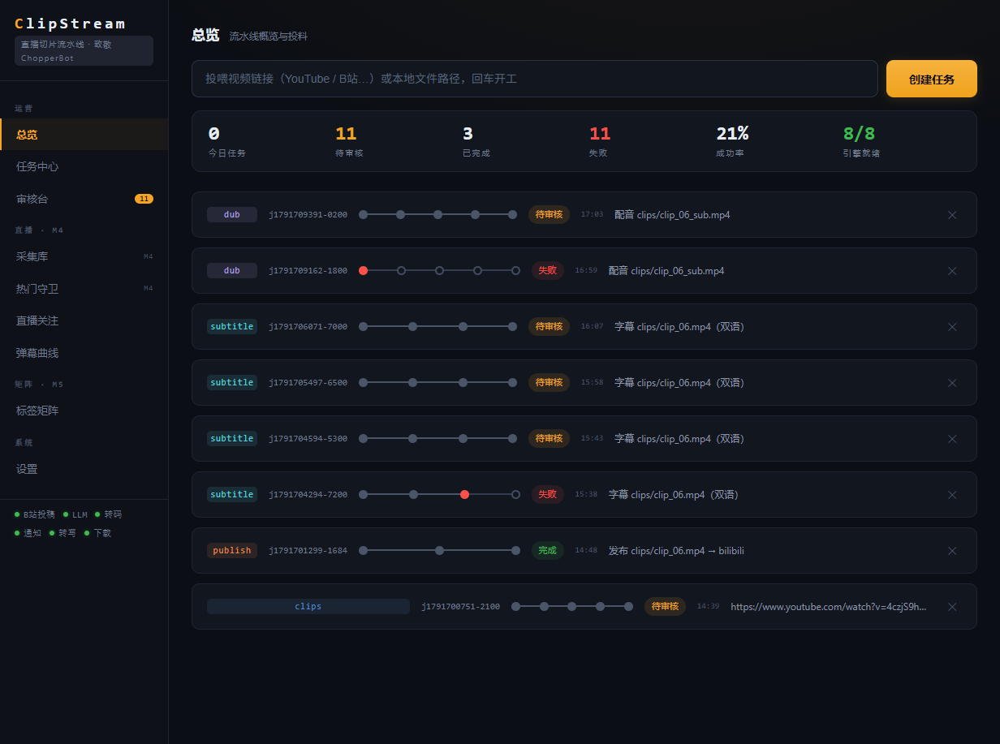
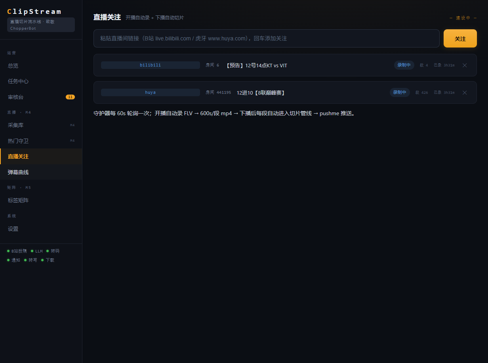
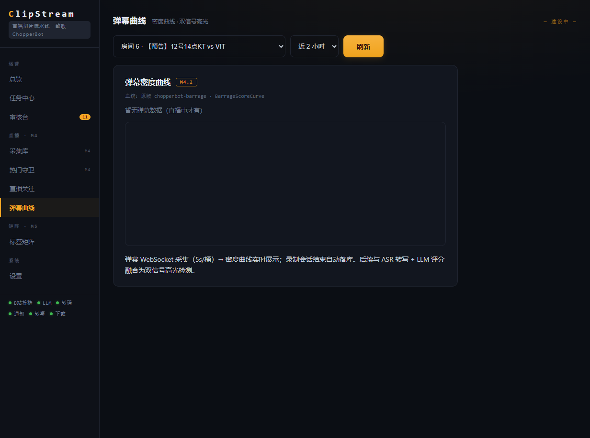
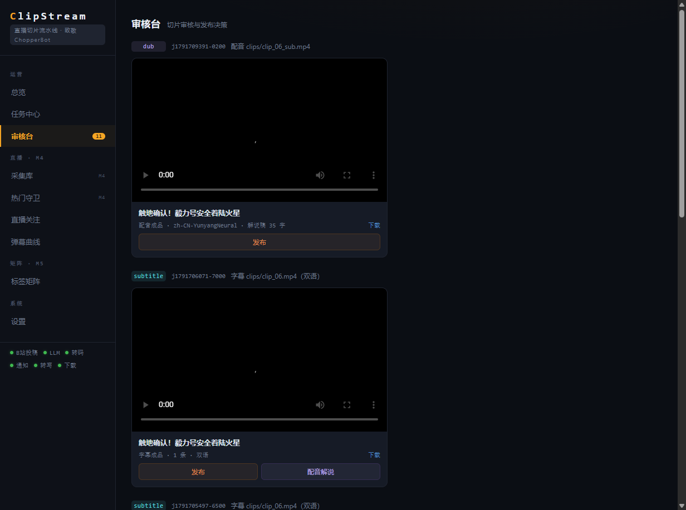
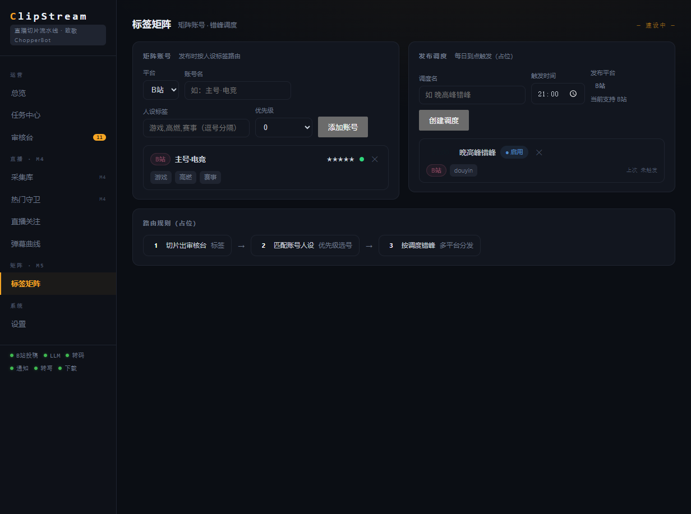

# ClipStream

> 直播录制 · 智能切片 · 搬运下载 · 翻译配音 · 多平台自动发布，一体化流水线。

**致敬与致谢**：本项目是 [Geniusay/ChopperBot](https://github.com/Geniusay/ChopperBot)（Apache-2.0，Java 直播切片机器人）的 **Go 重写与融合版**。模块地图（Board / Task Center / Live Follow / Barrage Curve / Label Manage 等）、双信号高光思路、多平台发布思想均借鉴自原版，特此致谢。原版源码仅供研读，未随本仓库分发。

## 截图

| 总览（流水线投料） | 直播关注（开播自动录） | 弹幕曲线（密度桶） |
|---|---|---|
|  |  |  |

| 审核台（发布前人工过审） | 标签矩阵（账号 + 错峰调度） |
|---|---|
|  |  |

## 它是什么

一条 **直播 → 切片 → 发布** 的自动化流水线：

```
开播检测 → 自动录制(分段) → 弹幕采集(密度桶) → 高光(ASR 转写 + 弹幕热点双信号)
         → 切片 → 人工审核 → B站投稿(biliup) → 推送通知(pushme)
```

以及独立的**搬运链**：任意视频 URL（YouTube / B站 / 抖音…）→ 下载 → 转写 → 高光 → 切片 → 字幕/配音 → 审核 → 发布。

## 当前支持

| 能力 | 状态 |
|---|---|
| 视频下载 / 转写 / 高光 / 切片 / 审核 | ✅ |
| 直播录制（B站 + 虎牙：开播检测、分段、断流续写） | ✅ |
| 弹幕密度采集（B站 + 虎牙，5s 桶实时曲线） | ✅ |
| 双信号高光融合（ASR 转写 + 弹幕热点 → LLM 选段） | ✅ |
| 字幕（LLM 翻译 + 烧录） / 配音（edge-tts 解说） | ✅ |
| 发布（B站：biliup 投稿；审核台 dry-run 演练） | ✅ |
| 矩阵账号 / 发布调度 | 骨架（账号仅 B站） |

其他平台（抖音 / 小红书 / 快手）发布与账号登录**尚未接入**，按用户需求经 Issue 排期。

## 快速开始

```bash
# 1. 环境：Go 1.22+；可选引擎（缺省自动降级）：
#    yt-dlp / ffmpeg / ffprobe / whisper.cpp(ASR) / biliup(B站发布) / LLM(DeepSeek 等 OpenAI 兼容)

# 2. 构建
go build -o bin/clipstream.exe ./cmd/clipstream
go build -o bin/clipstream-daemon.exe ./cmd/clipstream-daemon

# 3. 初始化
cp config.example.yaml config.yaml    # 按需填写引擎路径与 LLM key
./bin/clipstream init

# 4. 控制台
./bin/clipstream serve                # http://127.0.0.1:8899

# 5. 直播录制守护进程（独立进程，与 serve 分离）
./bin/clipstream-daemon

# 6. 命令行跑一个任务（视频 URL 或本地文件）
./bin/clipstream run -i "https://www.bilibili.com/video/BVxxxx"
```

控制台包含：总览 / 任务中心 / 审核台 / 直播关注 / 弹幕曲线 / 标签矩阵 / 设置。

## 使用要点

- **发布需人工审核**：切片产出进入「审核台」，发布前必须过审（默认 dry-run 演练，确认后真发）。
- **B站登录**：`./bin/clipstream login --platform bilibili`（biliup 弹窗扫码）；登录态存于本地 `data/accounts/`（不入库、不上传）。
- **直播录制**：控制台「直播关注」添加 B站/虎牙直播间 → daemon 自动检测开播/录制/下播切片。
- **LLM 可缺省**：未配置 api_key 时高光自动回退为等分切片或弹幕热点切片，全链可跑。
- **配置**：`config.yaml`（已 .gitignore，含密钥不入库）。

## 技术要点

- 纯 Go，单二进制；SQLite（modernc.org/sqlite，无 cgo）。
- 引擎全部外挂：yt-dlp / ffmpeg / whisper.cpp / biliup / LLM，均支持优雅降级。
- 直播录制守护进程与 Web 控制台**进程分离**：绕开 Windows 下父进程拉起子进程的 FLV 流式 IO 问题。
- 弹幕：B站走 WebSocket（wbi 签名 + uid=0 认证），虎牙走 va 边缘节点订阅协议（baseinfo + live/chat 频道），均按 5s 密度桶落库。
- 双信号高光：ASR 转写（LLM 语义）+ 弹幕密度（观众互动峰值）融合选段；无 LLM 时弹幕热点直接切片。

## 目录结构

```
cmd/clipstream          主程序（serve/run/init/login/status）
cmd/clipstream-daemon   直播录制守护进程
internal/config         配置（config.example.yaml）
internal/core           任务模型与事件总线
internal/engine         yt-dlp / ffmpeg / whisper / LLM / biliup 封装
internal/live           直播链：B站/虎牙 API、录制、弹幕采集
internal/pipeline       五类管线（clips/publish/subtitle/dub/live）
internal/store          SQLite（jobs/watches/barrage/accounts/schedules）
internal/web            控制台（单页 embed）
configs/platforms       发布平台选择器配置
docs/                   文档与截图
```

## License

[Apache-2.0](LICENSE)。

- 本项目为 **ChopperBot 的独立重写**：代码为全新 Go 实现，模块设计 / 思路受 [Geniusay/ChopperBot](https://github.com/Geniusay/ChopperBot)（Apache-2.0）启发，特此致谢。
- 依赖的引擎与库遵守各自许可证（biliup / whisper.cpp / yt-dlp / rod 等）。

## 反馈

- Bug / 功能需求：欢迎在 GitHub **Issue** 留言（新平台接入、新引擎、新发布渠道等）。
- 项目不定期迭代，不承诺具体交付排期。